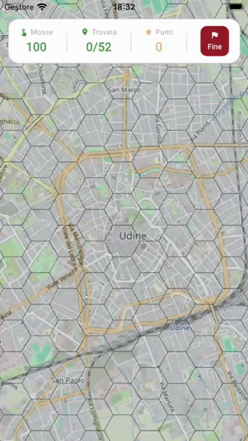
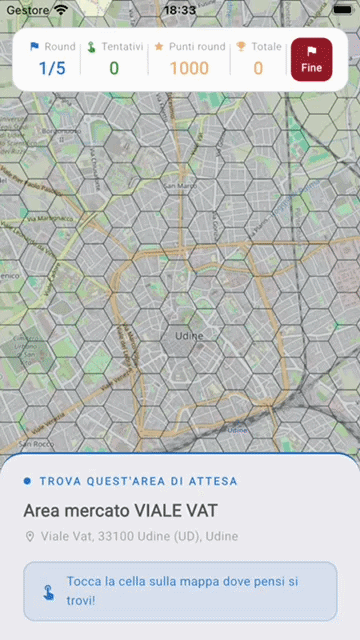
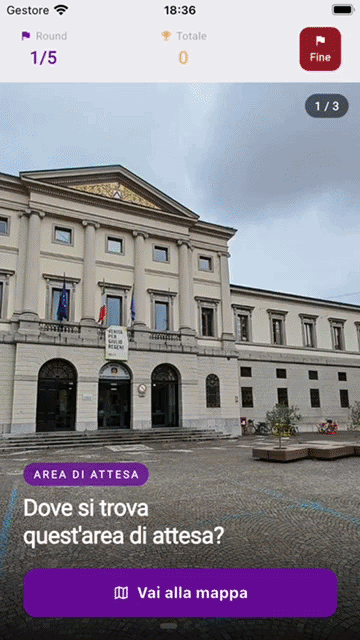

# Aree Attesa UD | Serious Game


> Un'applicazione mobile basata sul *Game-Based Learning* per educare i cittadini a localizzare le aree di emergenza della Protezione Civile, trasformando dati cartografici in un'esperienza interattiva che salva vite.

🎓 **Progetto di Tesi di Laurea in Informatica** - *Università degli Studi di Udine* (A.A. 2025-2026).

---

<!--  SEGNAPOSTO: IMMAGINE EROE (Consiglio: un'immagine con 3 mockup di telefoni affiancati che mostrano i 3 giochi) 
<p align="center">
  
</p> 

--- -->

## Il Progetto (Context)

In caso di calamità (es. terremoto), i Piani Comunali di Protezione Civile prevedono delle **Aree di Attesa**: luoghi sicuri dove la popolazione deve radunarsi per ricevere prima assistenza. Il problema? **La maggior parte dei cittadini non sa dove si trovino.**

I tradizionali opuscoli cartacei si sono rivelati inefficaci per la memorizzazione spaziale. **Aree Attesa UD** affronta questo problema applicando i principi dell'*Human-Computer Interaction* (HCI) e del *Serious Game*: permette ai cittadini di Udine di esplorare, sbagliare e memorizzare la mappa della propria città in un ambiente sicuro e gamificato.

---

## Modalità di Gioco

L'app allena l'apprendimento spaziale attraverso tre meccaniche distinte:

### 1. Campo Fiorito (Esplorazione)
L'utente scopre la posizione delle aree tappando su una griglia esagonale. Il colore delle celle fornisce un feedback visivo ("caldo/freddo") sulla distanza dall'area nascosta più vicina.
<!-- SEGNAPOSTO: GIF GIOCO A -->
> *Gioco A*


### 2. Localizza l'Area (Riconoscimento per nome)
Viene fornito il nome e l'indirizzo di un'area. L'utente deve individuarla sulla mappa: ogni tap errato mostra la distanza in celle dal bersaglio, costringendo l'utente a "triangolare" la posizione corretta.
<!-- SEGNAPOSTO: GIF GIOCO B -->
> *Gioco B*


### 3. GeoGuesser UD (Riconoscimento Visivo)
Viene mostrata una fotografia reale di un'area di attesa. L'utente deve riconoscere il contesto urbano e posizionare un *pin* sulla mappa il più vicino possibile alla realtà.
<!-- SEGNAPOSTO: GIF GIOCO C -->
> *Gioco C*


---

## Under the Hood (Architecture & Tech Stack)

Il progetto è stato sviluppato con **Flutter** applicando rigorosi principi di Ingegneria del Software per garantire scalabilità e manutenibilità.

### Architettura Feature-First
Il codice è strutturato per feature (`game_a`, `game_b`, `game_c`, `core`). Ogni modulo rispetta il **Single Responsibility Principle (SRP)** ed è stratificato in:
*   `screens`: UI pura e dichiarativa.
*   `providers`: State management reattivo tramite **Riverpod**.
*   `services`: **Business logic pura in Dart**, priva di dipendenze dal framework Flutter.

### Algoritmi e Scelte Tecniche di Rilievo
*   **Ray-Casting Algorithm:** Implementato da zero nel modello `HexCell` per determinare matematicamente se il tap dell'utente (Lat/Lon) cade all'interno di un poligono esagonale irregolare.
*   **BFS Multi-Sorgente:** Per il *Gioco A*, il calcolo delle distanze della griglia utilizza una Breadth-First Search (BFS) partendo simultaneamente da tutti i nodi bersaglio, calcolando l'intera mappa in tempo `O(V+E)`.
*   **Rendering Ottimizzato:** La griglia esagonale (centinaia di celle) è renderizzata tramite un `CustomPainter` su un singolo canvas, garantendo i 60fps durante il pan/zoom della mappa (`flutter_map`).
*   **Exponential Scoring Decay:** Nel *Gioco C*, il punteggio non decresce linearmente, ma segue una curva esponenziale (`score = maxScore * e^(-d/k)`) per premiare l'estrema precisione e penalizzare rapidamente gli errori macroscopici.

---

## Data Preparation (Python Pipeline)

L'applicazione mobile è *client-side* e funziona offline per la logica di gioco (scarica solo le *tile* cartografiche da OpenStreetMap). La complessa geometria esagonale è pre-calcolata:

Sono stati sviluppati due script **Python** (`geopandas`, `shapely`) che:
1.  Interrogano le API REST di **Nominatim** per estrarre i confini comunali esatti.
2.  Generano una griglia *flat-topped* con raggio di 183 metri (bilanciata matematicamente per il gameplay).
3.  Eseguono uno *spatial join* tra gli esagoni e gli open-data GeoJSON della Protezione Civile FVG per creare il file `grid.json` servito all'app.

---

## Quickstart

Per eseguire il progetto in locale:

```bash
# 1. Clona il repository
git clone https://github.com/fabb99/aree-attesa-ud.git

# 2. Entra nella cartella del progetto
cd aree-attesa-ud

# 3. Scarica le dipendenze
flutter pub get

# 4. Avvia l'app (assicurati di avere un emulatore o un device fisico collegato)
flutter run